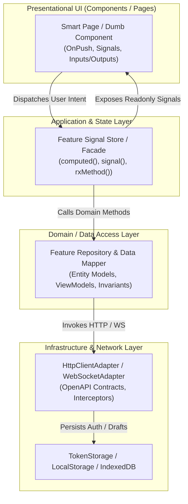

# NukkadNow Frontend UI & Merchant App — Master Sprint Roadmap

**Document ID:** NNK-FE-ROADMAP-001  
**Version:** 1.0  
**Status:** Engineering Execution Baseline  
**Product:** NukkadNow — Locality-First Commerce Marketplace & Merchant SaaS  
**Market:** India; Launch Pilot in Nagpur  
**Frontend Architecture:** pnpm workspace, Angular 18+ Standalone, Ionic Angular Mobile Shell, Turborepo  
**Primary Specification Reference:** `NUKKADNOW_MERCHANT_APP_UI_SPECIFICATION.md` & `NUKKADNOW_REPOSITORY_ARCHITECTURE.md`  
**Target Applications:** 
1. `customer-pwa` (Customer Mobile PWA)
2. `merchant-portal` / `merchant-app` (Merchant Operations Workspace on Mobile & Web)  
**Cadence:** 2-Week Sprints (Sprint 00 is 1 Week Foundation)

---

## 1. Executive Architecture Summary

NukkadNow Merchant is the mobile-first operating system for neighborhood businesses—from Kirana stores and sweet shops to home bakers, artisan makers, and seasonal pop-up stalls. A merchant must be able to run complete day-to-day operations (orders, live queue, stock, capacity, and walk-in counter billing) from an affordable smartphone without owning a PC, while enjoying an advanced desktop workspace for bulk edits, reporting, and staff management.

This roadmap organizes the entire frontend user interface and application layer into **16 sequential, modular, and test-driven sprints**. Each sprint is architected to be:
- **DRY (Don't Repeat Yourself):** Zero code duplication across Customer and Merchant experiences. Common widgets, design tokens, formatters, and API adapters live in `@nukkadnow/ui`, `@nukkadnow/utilities`, and `@nukkadnow/api-client`.
- **KISS (Keep It Simple, Stupid):** Intuitive 1-tap or 2-tap operational actions for merchants on the go. No complex desktop-centric modal chains on mobile screens.
- **SOLID Principles:** Strict Clean Architecture separation (Presentational Components $\rightarrow$ Feature Stores/Facades $\rightarrow$ Data Access Repositories $\rightarrow$ Generated API Client).
- **Hardened Security:** Tenant and outlet isolation headers, cryptographic token refresh rotation, zero client-side credential trust, privacy protection for home-based seller addresses, strict XSS sanitization, and masked customer PII.
- **High Scalability:** Signal-based fine-grained reactivity, `OnPush` change detection, lazy route chunks, virtual scrolling for large order queues, and resilient WebSocket reconnect relays with exponential backoff.

---

## 2. Sprint Schedule & Delivery Matrix

| Sprint ID | Name | Core Domain & Focus | Key Deliverables & Milestones |
|---|---|---|---|
| **Sprint 00** | Architecture Foundation & Tooling | Workspace, Monorepo Boundaries, Tooling | Monorepo setup, ESLint boundary rules, Turborepo caching, Signal Store conventions |
| **Sprint 01** | Design System & UI Kit | Design Tokens, Primitives, Locality UI | Warm Saffron theme, typography, buttons, inputs, modals, commerce cards, badges |
| **Sprint 02** | Merchant Auth & Session Security | Phone + OTP, JWT Tokens, Auth Guards | OTP login flow, 60s cooldown, token refresh rotation, session persistence, role guards |
| **Sprint 03** | Onboarding & Seller Verification | 7-Step Wizard, Seller Modes, Drafts | Business registration, Seller Mode selection, Home-seller address masking, KYC/FSSAI |
| **Sprint 04** | Outlet Context & Operating Hours | Multi-Outlet Switcher, Shop Controls | Active outlet switcher, Open/Pause/Close toggles, Weekly schedule, Holiday calendar |
| **Sprint 05** | Catalogue & Media Management | Products, Categories, Variants, Uploads | Product CRUD, multi-attribute variants, made-to-order lead time, compressed uploads |
| **Sprint 06** | Real-Time Inventory & Stock Alerts | Atomic Adjustments, Low Stock, Audit | Fast stock increment/decrement, out-of-stock toggles, stock history, web CSV import |
| **Sprint 07** | Live Order Inbox & Audio Chimes | Order Lifecycle, WebSocket, Audio Alert | Priority order queue, incoming order audio chime, accept/reject modal, prep timer |
| **Sprint 08** | Order Detail, Timeline & Audit | Order Inspection, Handover, Privacy | Order item breakdown, customer instructions, fulfillment tokens, private kitchen notes |
| **Sprint 09** | Queue Display & Walk-In Billing | Kitchen Display, Fast Counter POS Billing | Real-time queue board, quick walk-in order creator, offline billing draft, token caller |
| **Sprint 10** | Capacity Throttle & Pickup Slots | Dynamic Slots, Preorders, Batch Baking | Interval order limits, pickup slot scheduling, advance preorder cutoff, batch dates |
| **Sprint 11** | QR Ordering & Self-Delivery | Standee QR Generator, Delivery Settings | Table/Counter printable QR codes, delivery geofencing, radius/pincode fees, dispatch |
| **Sprint 12** | Staff Roles & Outlet Permissions | RBAC, PIN Lockout, Granular Directives | Cashier/Kitchen/Manager roles, PIN switch, `[merchantHasPermission]` directive |
| **Sprint 13** | Operational Analytics & Reports | Sales Metrics, Rush Hours, CSV Exports | Today's sales, average prep time, on-time pickup rate, top products, report download |
| **Sprint 14** | Subscriptions, Billing & Invoices | SaaS Tiers, Plan Limits, Tax Invoices | Plan upgrade, active quota meters, GST invoice downloads, platform fee breakdown |
| **Sprint 15** | Offline Sync, PWA Shell & Launch | Service Workers, Capacitor, Nagpur UAT | Offline cache fallback, capacitor mobile builds, end-to-end UAT, pilot merchant launch |

---

## 3. Architectural Tenets & Coding Standards

### 3.1 DRY (Don't Repeat Yourself)
1. **Shared Primitives**: All form inputs, modals, buttons, chips, and price displays originate from `@nukkadnow/ui`. No component creates custom HTML input styling.
2. **Centralized Utilities**: Currency calculations in paise, relative date displays, and Indian phone/pincode validators are centralized in `@nukkadnow/utilities`.
3. **Generated API Contracts**: Generated TypeScript interfaces from OpenAPI schemas (`@nukkadnow/api-client`) are the single source of truth for network payloads.

### 3.2 KISS (Keep It Simple, Stupid)
1. **Zero Desktop Bloat on Mobile**: Mobile viewports focus exclusively on actionable cards with large 48px touch targets.
2. **Direct State Transitions**: Order state transitions (`ACCEPT`, `PREPARING`, `READY`, `HANDOVER`) require at most two clicks with confirmation.
3. **Pragmatic State Management**: Local feature state uses lightweight Angular Signals; complex inter-stream coordination uses RxJS. No heavy boilerplate state libraries.

### 3.3 SOLID Principles Implementation
- **Single Responsibility Principle (SRP)**: UI components strictly render view markup and emit user actions. State stores manage reactive signals. Repositories coordinate API calls and data mapping.
- **Open/Closed Principle (OCP)**: Seller mode behaviors (Permanent Shop, Home Maker, Seasonal, Made-to-Order) are configured via polymorphic strategy providers without altering the core checkout or order engine.
- **Liskov Substitution Principle (LSP)**: All API client adapters implement consistent contract interfaces (`HttpClientAdapter`, `WebSocketAdapter`).
- **Interface Segregation Principle (ISP)**: Feature models expose client-tailored ViewModels (`OrderSummaryViewModel`, `OrderDetailViewModel`) rather than passing raw backend database entities to templates.
- **Dependency Inversion Principle (DIP)**: Components and stores depend on abstract service tokens injected via Angular's `inject()`, facilitating clean mocking in unit tests.

### 3.4 Security & Data Privacy Hardening
1. **Address Protection for Home Sellers**: When `isHomeMaker: true`, the private street address is masked across all public discovery screens and restricted to locality/pickup point only.
2. **Customer Data Minimization**: Order views only expose necessary customer information (first name, pickup token, requested time, order items). Phone numbers are masked or routed through click-to-call.
3. **Session & Token Security**:
   - Access tokens stored in memory/session storage; refresh tokens stored with strict rotation policies.
   - All outgoing requests automatically tagged with `x-tenant-id`, `x-outlet-id`, and `x-correlation-id`.
   - Automatic session eviction upon 401 Unauthorized responses with return URL redirection.
4. **Input Sanitization & Validation**:
   - Reactive forms enforce strict typed validations (non-negative price, Indian mobile format, safe text).
   - Strict Angular template sanitization protects against XSS injection in merchant descriptions.

---

## 4. Definition of Done (DoD) per Sprint

A sprint is formally complete only when:
- [ ] Every user story and screen matches the mobile/web layout specifications.
- [ ] Responsive behavior verified on small Android (360px), iOS (390px), iPad (820px), and Desktop (1440px).
- [ ] Component Change Detection is strictly `OnPush` with Angular Signals.
- [ ] Zero ESLint and boundary rule violations (`pnpm check:boundaries` and `pnpm lint`).
- [ ] Unit tests written for Stores, Mappers, and Repositories with $\ge 80\%$ code coverage.
- [ ] Error, loading, empty, and offline fallback states gracefully handled in UI.
- [ ] Endpoints integrated with typed contracts and verified against backend API schemas.
- [ ] Documentation and feature changelog updated in `docs/sprints/`.
