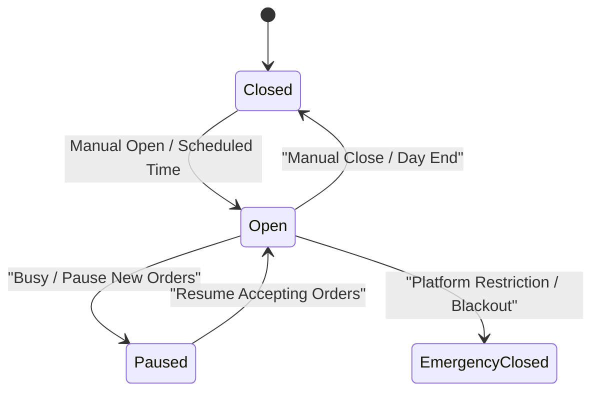

# Sprint 04 — Outlet Context, Shop Status & Operating Hours

- **Sprint ID:** NNK-FE-SPRINT-04
- **Duration:** 2 Weeks
- **Target Apps:** `merchant-portal`, `libs/domain-models`
- **Goal:** Implement the multi-outlet context switcher, emergency Shop Pause / Close toggle, weekly operating schedules, and holiday blackout calendars.

---

## 1. Principles & Coding Standards

### DRY & KISS
- **Context Injection:** Active outlet ID is maintained in `OutletSwitcherStore` and automatically appended to all outgoing requests via `tenant-header.interceptor.ts`.
- **KISS Status Switch:** A prominent, persistent header widget allows the merchant to switch between **Open**, **Paused (Busy)**, and **Closed** in a single tap.

### SOLID Standards
- **Single Responsibility:** `ShopStatusService` manages real-time availability state, while `OperatingHoursService` handles weekly schedule CRUD.

---

## 2. Shop State Machine & UI Controls

### Visual Feedback
- **Open (Green):** Accepting incoming orders normally.
- **Paused / Busy (Amber):** Shop remains visible on marketplace, but new checkout attempts show: *"Merchant is currently busy. Next available slot in 45 mins."*
- **Closed (Gray/Red):** Marketplace orders disabled; shows next scheduled opening time.

---

## 3. Endpoints & API Specifications

| Method | Endpoint | Description |
|---|---|---|
| `GET` | `/api/v1/merchant/outlets` | List all outlets owned by tenant |
| `GET` | `/api/v1/merchant/outlets/:id/status` | Current live operational status |
| `PATCH` | `/api/v1/merchant/outlets/:id/status` | Change status (OPEN, PAUSED, CLOSED) |
| `GET` | `/api/v1/merchant/outlets/:id/hours` | Fetch 7-day operating schedule |
| `PUT` | `/api/v1/merchant/outlets/:id/hours` | Update operating hours and holiday dates |

---

## 4. Definition of Done (DoD)
- [ ] Outlet switcher persists selected outlet across page refreshes.
- [ ] 1-tap "Pause Orders" prompt asks for pause duration (30 mins, 1 hr, remainder of day).
- [ ] Weekly operating hours matrix validates open time is before close time.
- [ ] Outgoing HTTP requests include `x-outlet-id: <selected_outlet_uuid>`.
