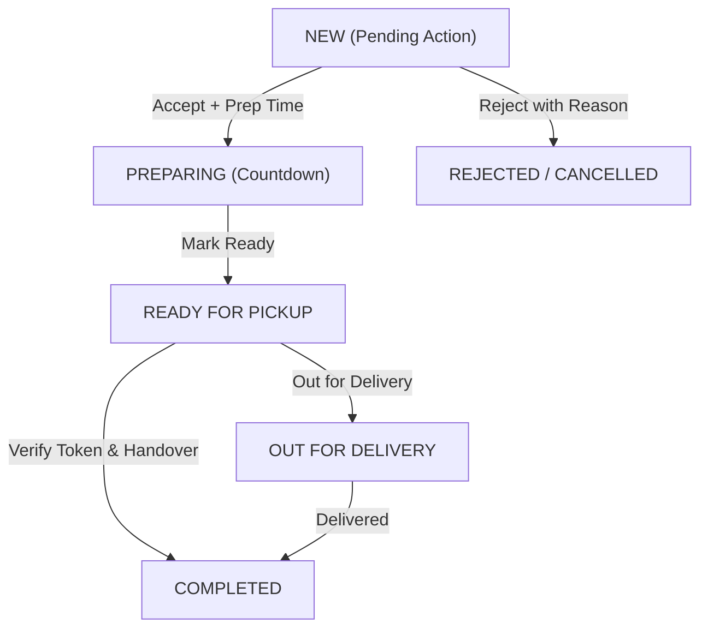

# Sprint 07 — Live Order Inbox, Order Lifecycle & Audio Chimes

- **Sprint ID:** NNK-FE-SPRINT-07
- **Duration:** 2 Weeks
- **Target Apps:** `merchant-portal`, `libs/api-client`, `libs/domain-models`
- **Goal:** Implement the high-priority real-time order inbox, WebSocket live updates, audio alert chimes on new orders, prep time selection, and robust state machine transitions.

---

## 1. Principles & Coding Standards

### DRY & KISS
- **KISS Order Actions:** Primary action button is prominent and dynamic:
  - New Order $\rightarrow$ **Accept** (Green) or **Reject** (Red)
  - Accepted $\rightarrow$ **Start Preparing**
  - Preparing $\rightarrow$ **Mark Ready for Pickup**
  - Ready $\rightarrow$ **Complete / Handover**
- **Web Audio Alert:** Synthesized chime plays via Web Audio API (`AudioAlertService`) without external audio file dependencies.

### SOLID Standards
- **Single Responsibility:**
  - `OrderInboxStore`: Manages active order buckets (`NEW`, `PREPARING`, `READY`).
  - `AudioAlertService`: Manages oscillator audio and handles browser autoplay permissions.
  - `OrderActionDialogs`: Handles rejection reasons or prep time adjustments.

---

## 2. Order Lifecycle State Machine

---

## 3. Endpoints & API Specifications

| Method | Endpoint | Description |
|---|---|---|
| `GET` | `/api/v1/merchant/orders/inbox` | Real-time order queue bucketed by status |
| `POST` | `/api/v1/merchant/orders/:id/accept` | Accept order with estimated prep minutes |
| `POST` | `/api/v1/merchant/orders/:id/reject` | Reject order with reason code and optional note |
| `POST` | `/api/v1/merchant/orders/:id/start-prep` | Transition to PREPARING |
| `POST` | `/api/v1/merchant/orders/:id/mark-ready` | Transition to READY (notifies customer) |
| `POST` | `/api/v1/merchant/orders/:id/complete` | Complete order with digital token validation |
| `WS` | `/merchant/outlets/:outletId/inbox-stream` | Realtime WebSocket feed for order state changes |

---

## 4. Definition of Done (DoD)
- [ ] Incoming new orders trigger sound alert and prominent banner.
- [ ] Rejecting an order prompts for mandatory reason code (e.g. *Out of Stock*, *Kitchen Over capacity*).
- [ ] Acceptance dialog allows quick prep-time selection (+15m, +30m, +45m).
- [ ] WebSocket reconnects automatically with exponential backoff on network drop.
