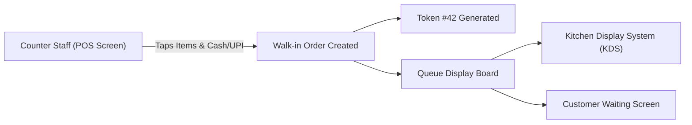

# Sprint 09 — Queue Display Board & Walk-In Counter POS Billing

- **Sprint ID:** NNK-FE-SPRINT-09
- **Duration:** 2 Weeks
- **Target Apps:** `merchant-portal`, `libs/ui`
- **Goal:** Build the unified kitchen/customer queue board, rapid walk-in counter POS billing interface, offline billing draft support, and instant physical pickup token generation.

---

## 1. Principles & Coding Standards

### DRY & KISS
- **KISS Counter Billing:** 3-tap physical sale entry: Tap Product $\rightarrow$ Select Quantity $\rightarrow$ Generate Token. Takes $< 5$ seconds at the register.
- **Unified Order Model:** Walk-in orders flow through the exact same order state machine as marketplace and QR orders, ensuring accurate kitchen queue metrics.

### SOLID Standards
- **Single Responsibility:** `WalkinBillingStore` manages fast cart building and local storage drafts; `QueueBoardComponent` displays full-screen prep board for kitchen monitors.

---

## 2. Walk-In Billing & Queue Architecture

### Visual Specifications
- **Queue Display Board (KDS Mode):** Split-screen layout:
  - Left Panel: **Now Preparing** (Tokens #12, #14, #15) with live countdown timers.
  - Right Panel: **Ready for Pickup** (Tokens #09, #11) with green pulsing tokens.
- **Walk-in Fast POS:** Grid of quick-tap product tiles with real-time stock indicators.

---

## 3. Endpoints & API Specifications

| Method | Endpoint | Description |
|---|---|---|
| `POST` | `/api/v1/merchant/walk-ins` | Create walk-in order and issue sequential token |
| `GET` | `/api/v1/merchant/queue/board` | Unified queue board snapshot |
| `PATCH` | `/api/v1/merchant/queue/call-token` | Announce / trigger token caller chime |

---

## 4. Definition of Done (DoD)
- [ ] Walk-in POS allows rapid order creation in under 5 seconds.
- [ ] Instant token generated and formatted for 80mm/58mm thermal receipt printers.
- [ ] Full-screen Queue Display Board renders clearly on high-resolution TVs/tablets.
- [ ] Offline walk-in draft survives network blips and queues for sync when online.
