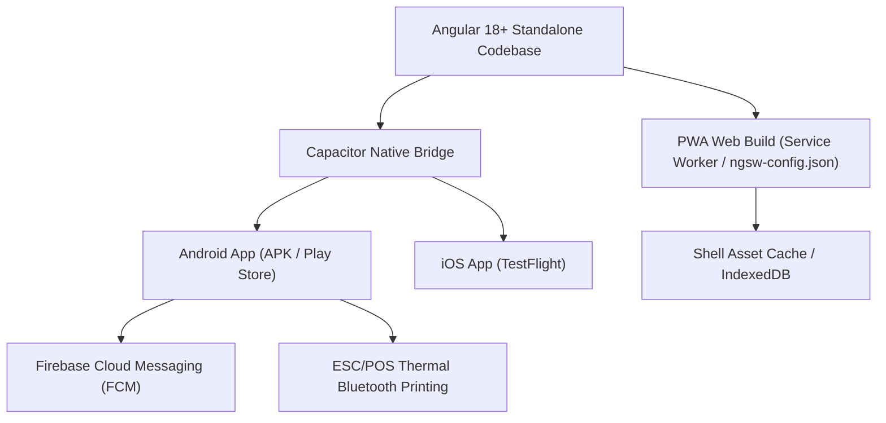

# Sprint 15 — Offline Sync, PWA Service Worker & Nagpur Pilot Launch

- **Sprint ID:** NNK-FE-SPRINT-15
- **Duration:** 2 Weeks
- **Target Apps:** `customer-pwa`, `merchant-portal`, `libs/testing`
- **Goal:** Harden the offline Service Worker cache, implement Capacitor native mobile builds (Android APK), configure push notification listeners, execute end-to-end integration tests, and conduct User Acceptance Testing (UAT) with pilot merchants in Nagpur.

---

## 1. Principles & Coding Standards

### DRY & KISS
- **Safe Offline Invariants:**
  - **Permitted Offline:** View cached product catalogue, browse past orders, draft a walk-in order.
  - **Strictly Prohibited Offline:** Never accept a marketplace order, never mark payment paid, never promise an unreserved pickup slot while offline.
- **Explicit Conflict State:** Local drafts display *"Pending sync"* chip with an explicit sync button when connection is restored.

### SOLID Standards
- **Platform Portability (DIP):** Native capabilities (Push Notifications, Camera, Thermal Bluetooth Printer, Secure Storage) reside behind abstract interfaces, with clean web fallbacks.

---

## 2. PWA & Capacitor Native Architecture

---

## 3. Nagpur Pilot UAT Verification Checklist

1. **Merchant Physical Reality:** Tested in bright daylight on affordable Android devices (e.g. Redmi / Realme with 4GB RAM).
2. **Network Resilience Drill:** App placed in Airplane mode while navigating; order inbox gracefully displays *"Offline - Showing cached orders (updated 2m ago)"*.
3. **Audio Chime Reliability:** Audio notification sounds audibly in a noisy retail shop when a new test order arrives.
4. **Thermal Printer Integration:** 1-tap print outputs clear 80mm kitchen ticket.
5. **Home Business Privacy Verification:** Zero leakage of home baker residential addresses during customer search and checkout.

---

## 4. Definition of Done (DoD)
- [ ] Production build budgets strictly under 500kB initial bundle for Customer PWA and under 1MB for Merchant Portal.
- [ ] Lighthouse PWA score $\ge 95$ across Performance, Accessibility, and Best Practices.
- [ ] Capacitor Android release APK generated and verified on physical Android 12+ hardware.
- [ ] 5 pilot merchants in Nagpur onboarded and successfully processing test orders end-to-end.
- [ ] All 16 sprint documentation artifacts signed off and published in `docs/sprints/`.
